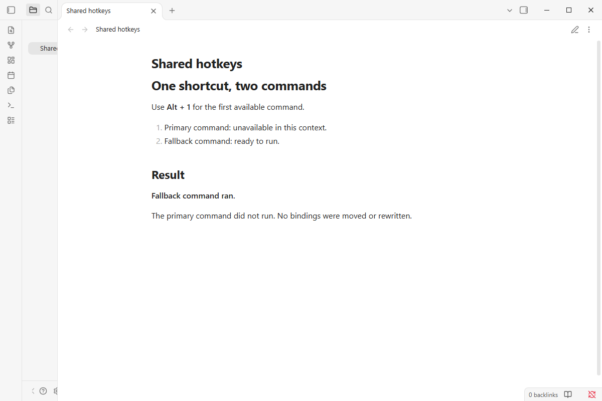

# Hotkey Fallback

   

When two commands share a shortcut, an unavailable first command can swallow it. `Hotkey Fallback` tries the next matching command and stops when one is available. Bind commands in Obsidian's Hotkeys settings; its native ordering remains in charge. Desktop only.

## Demo vault

**The documentation is a demo vault.** Every feature has a note that explains what it does and why you would want it, with a button you can press to watch it happen.

**[Start reading here](<./demo-vault/00 Start.md>)** — it is plain markdown, so it works on `GitHub` with nothing installed.

A copy of the vault ships with every release. You can access it via any of the following:

1. Running the **`Hotkey Fallback`: Open demo vault** command.
2. Downloading `hotkey-fallback-demo-vault.zip` from the [Releases](https://github.com/mnaoumov/obsidian-hotkey-fallback/releases). It unzips into a single `hotkey-fallback-demo-vault-<version>` folder.
3. Browsing its source in [`demo-vault/`](./demo-vault/README.md) in this repository.

## What it does

The first available command for a shortcut runs. Conditional editor commands work through Obsidian's own availability check. Unloading the plugin restores native dispatch.

See [Shared hotkeys](<./demo-vault/01 Shared hotkeys.md>) for setup, ordering and limitations.

## See also

[My other Obsidian resources](https://mnaoumov.dev/obsidian/)

| Plugin                                                                            | Features                           | How `Hotkey Fallback` differs                                                |
| --------------------------------------------------------------------------------- | ---------------------------------- | ---------------------------------------------------------------------------- |
| [`Commander`](https://community.obsidian.md/plugins/cmdr)                         | Places commands in the interface   | Related command access; uses existing shared hotkeys and availability checks |
| [`Hotkey Helper`](https://community.obsidian.md/plugins/hotkey-helper)            | Assignment and conflict management | Related hotkey management; changes dispatch of existing shared bindings      |
| [`Hotkeys Chords`](https://community.obsidian.md/plugins/obsidian-hotkeys-chords) | Key sequences invoke commands      | Related command shortcuts; tries candidates for one existing combination     |

Last searched for similar plugins on 2026-11-03.

## Installation

The plugin is not available in [the official Community Plugins repository](https://community.obsidian.md) yet.

### Beta versions

To install the latest beta release of this plugin (regardless if it is available in [the official Community Plugins repository](https://community.obsidian.md) or not), follow these steps:

1. Ensure you have the [BRAT plugin](https://community.obsidian.md/plugins/obsidian42-brat) installed and enabled.
2. Click [Install via BRAT](https://intradeus.github.io/http-protocol-redirector?r=obsidian://brat?plugin=https://github.com/mnaoumov/obsidian-hotkey-fallback).
3. An Obsidian pop-up window should appear. In the window, click the `Add plugin` button once and wait a few seconds for the plugin to install.

## Debugging

By default, debug messages for this plugin (id: `hotkey-fallback`) are hidden.

If you need to enable them refer to the [documentation](https://mnaoumov.dev/obsidian-lib/guides/debugging/).

## Changelog

All notable changes to this project will be documented in the [CHANGELOG](./CHANGELOG.md).

## Contributing

Contributions are welcome — see [CONTRIBUTING](./CONTRIBUTING.md) to get set up.

## Support

<!-- markdownlint-disable MD033 -->

<a href="https://www.buymeacoffee.com/mnaoumov" target="_blank">Support this plugin</a>

<!-- markdownlint-enable MD033 -->

### Filing an issue (for AI agents and humans)

Open issues through the [issue forms](https://github.com/mnaoumov/obsidian-hotkey-fallback/issues/new/choose), not as blank issues.

To report a bug from inside Obsidian, run the **`Hotkey Fallback`: Report a bug** command. It opens the bug form with the plugin version, the Obsidian version and your operating system already filled in.

Filing from the CLI or the API (`gh issue create --body`, or an AI agent filing for you) skips the form, and `gh issue create --template` cannot load an issue form. In that case, open the matching form in [`.github/ISSUE_TEMPLATE/`](https://github.com/mnaoumov/obsidian-hotkey-fallback/tree/HEAD/.github/ISSUE_TEMPLATE), copy every field as a `### <label>` heading in the form's order, and fill in each one. Always state the plugin version, the Obsidian version and your operating system.

## License

© [Michael Naumov](https://github.com/mnaoumov/)
